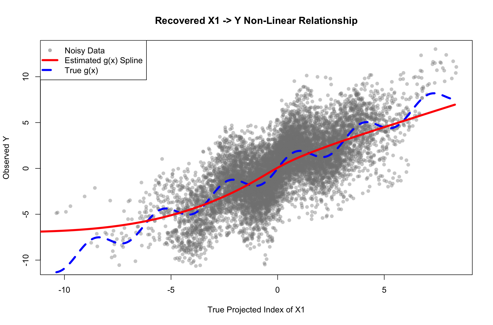
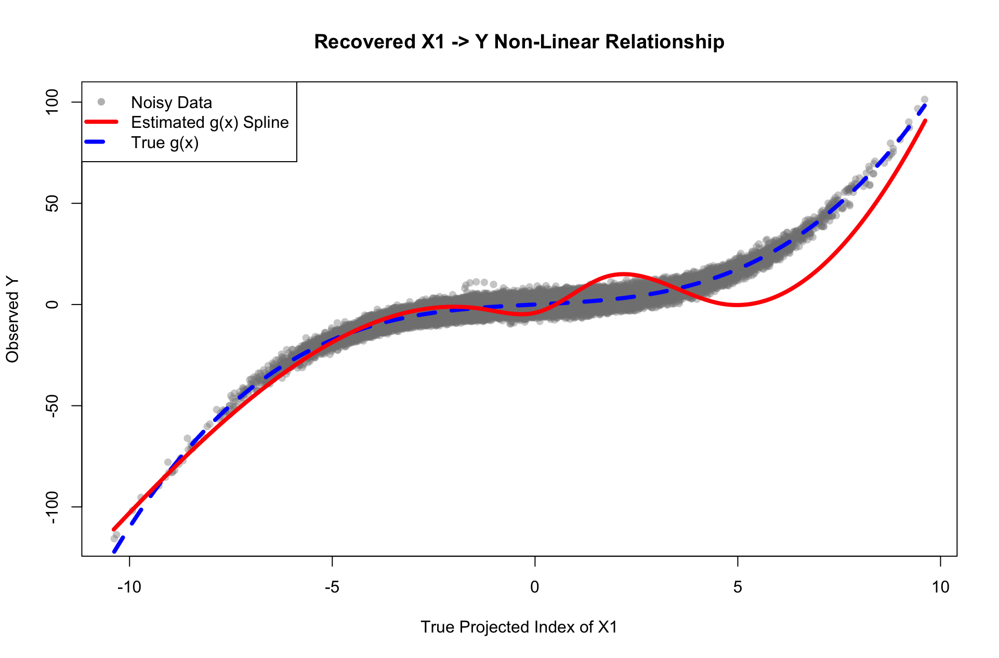
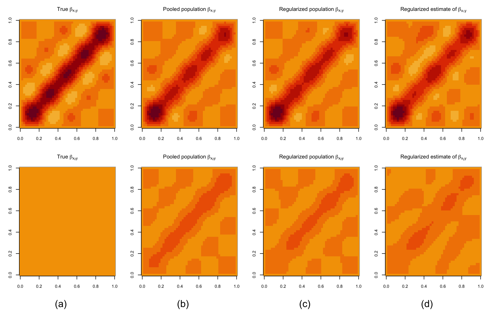
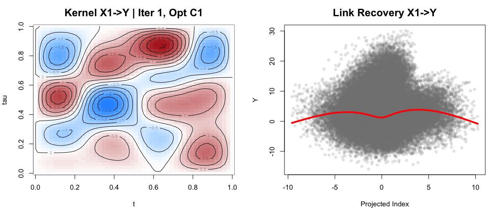

# Functional Worst-Risk Minimization in Non-Linear Models

Bachelor thesis, Università della Svizzera italiana (USI), Faculty of Informatics, 2026.

**Author:** Nazar Nasliednikov<br>
**Advisor:** Prof. Ernst-Jan Camiel Wit<br>
**Co-advisors:** Francisco Javier Richter Mendoza, Alessia Berarducci

**[Read the thesis (PDF)](paper/Nasliednikov_Bachelor_Thesis.pdf)** · **[Poster (PDF)](poster/Nasliednikov_Bachelor_Thesis_Poster.pdf)**

## Summary

Prediction models trained in one environment often fail when the data distribution shifts.
Kennerberg and Wit (2025) introduced *functional worst-risk minimization* for linear functional
models: a predictor that stays reliable under unseen shifts, with risk guarantees.

This thesis extends the framework to **non-linear** functional structural equation models,
using the Functional Additive Regression (FAR) single-index operator of Fan et al. (2015):

- **Theory.** For non-linear links the exact worst-risk decomposition no longer holds. The thesis
  proves a tight upper bound on the worst-case prediction risk under unseen distributional shifts.
- **Estimation.** A three-phase estimator:
  1. alternating block coordinate descent with BFGS and fast polynomial profiling to estimate the
     projection kernels;
  2. a cross-validated Group Lasso that removes unstable (spurious) variables;
  3. an unpenalized natural spline that recovers the shape of the non-linear link.
- **Simulations.** On a DAG `X1 -> Y -> X2` with an interventional shift on `X1` and `X2`,
  the estimator recovers the invariant cause `X1` and suppresses the spurious `X2`, for both a
  sinusoidal and a cubic link.

| Recovered link (sinusoidal) | Recovered link (cubic) |
|---|---|
|  |  |

**Variable selection.** Kernel heatmaps of the invariant cause `X1` (top row) and the spurious
variable `X2` (bottom row): the regularized estimator suppresses the spurious pathway.



**The optimization at work.** Each frame is one improvement of the coordinate descent: the
kernel for `X1` (left) and the link it implies (right).



## Contents

```
paper/    the thesis (PDF)
poster/   the poster (PDF)
figures/  the figures used in the thesis, by scenario
code/
  R/
    simulate.R    data generation for the functional SEM (both environments)
    estimate.R    the three-phase worst-risk estimator
    plots.R       functions that draw each figure
  scripts/
    run_simulation.R        full simulation study for one scenario
    shift_budget_regions.R  poster illustration of the shift sets C_A^gamma(A)
```

## Reproducing the results

Requirements: R (4.x) with the packages `grpreg` (Group Lasso) and `splines` (ships with R).
`gifski` is optional and only used to record the optimization animation.

```r
install.packages(c("grpreg", "gifski"))
```

Run from the `code/` folder:

```bash
cd code
Rscript scripts/run_simulation.R sinusoidal
Rscript scripts/run_simulation.R cubic
Rscript scripts/shift_budget_regions.R
# optional: also record the optimization as a GIF
Rscript scripts/run_simulation.R sinusoidal --gif
```

Each run writes its figures (PNG and PDF) and `metrics.txt` to `code/results/<scenario>/`.
Random draws come from a single stream started with `set.seed(42)`.
One run takes several minutes, because the coordinate descent runs BFGS on the full data set.

### Figures in the thesis and the script output

| Thesis | Output file |
|---|---|
| Figure 3, observational vs interventional environments | `fig03_environments` |
| Figure 4, pairwise-normalized kernel heatmaps | `fig04_kernel_heatmaps` |
| Figures 5-8, true vs estimated kernels | `fig05-08_kernels_3d` |
| Figure 9, recovered link function | `fig09_recovered_link` |
| Figure 10, prediction tracking on the shifted test set | `fig10_prediction_tracking` |
| Figure 11, 95% prediction interval | `fig11_prediction_interval` |
| Figure 12, actual vs predicted | `fig12_actual_vs_predicted` |
| Figure 13, residual analysis | `fig13_residuals` |
| Poster, shift budget regions | `shift_budget_regions` |

Figures 5-8 in the thesis were rendered interactively with `rgl`; the script draws the same
surfaces as static `persp` plots. Figures 1 (algorithm diagram) and 2 (DAG) were drawn by hand.

## References

- P. Kennerberg and E. C. Wit. *Functional worst risk minimization*, 2025. [arXiv:2412.00412](https://arxiv.org/abs/2412.00412)
- Y. Fan, G. M. James and P. Radchenko. *Functional additive regression*. The Annals of Statistics 43(5), 2015.
- J. Huang, P. Breheny and S. Ma. *A selective review of group selection in high-dimensional models*. Statistical Science 27(4), 2012.
- L. Kania and E. Wit. *Causal regularization: on the trade-off between in-sample risk and out-of-sample risk guarantees*, 2025. [arXiv:2205.01593](https://arxiv.org/abs/2205.01593)

The full reference list is in the thesis.

## License

The code is released under the [MIT License](LICENSE).
The thesis and the poster are © 2026 Nazar Nasliednikov.
